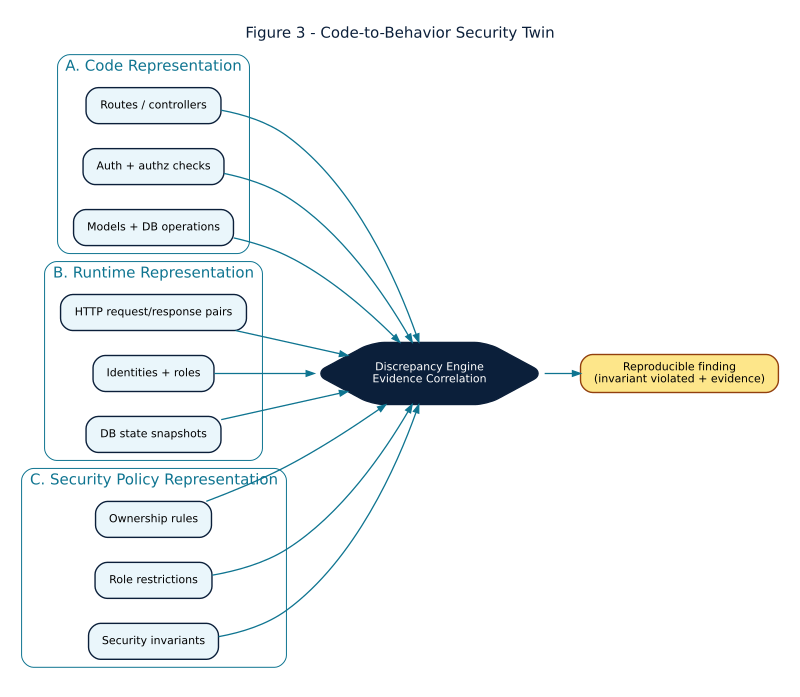
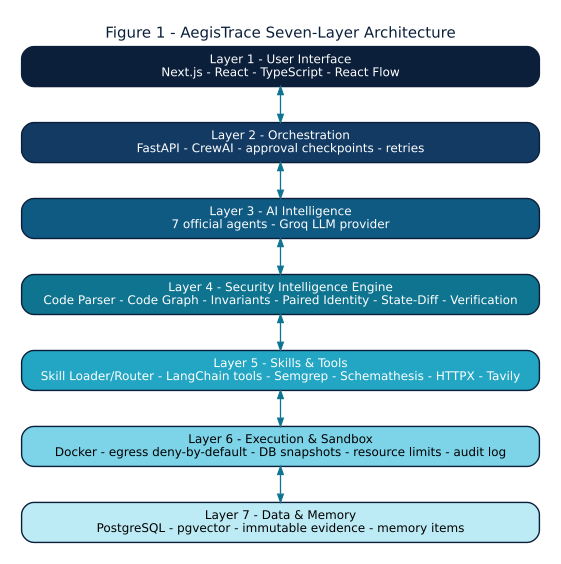
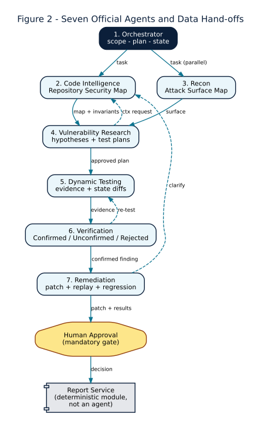
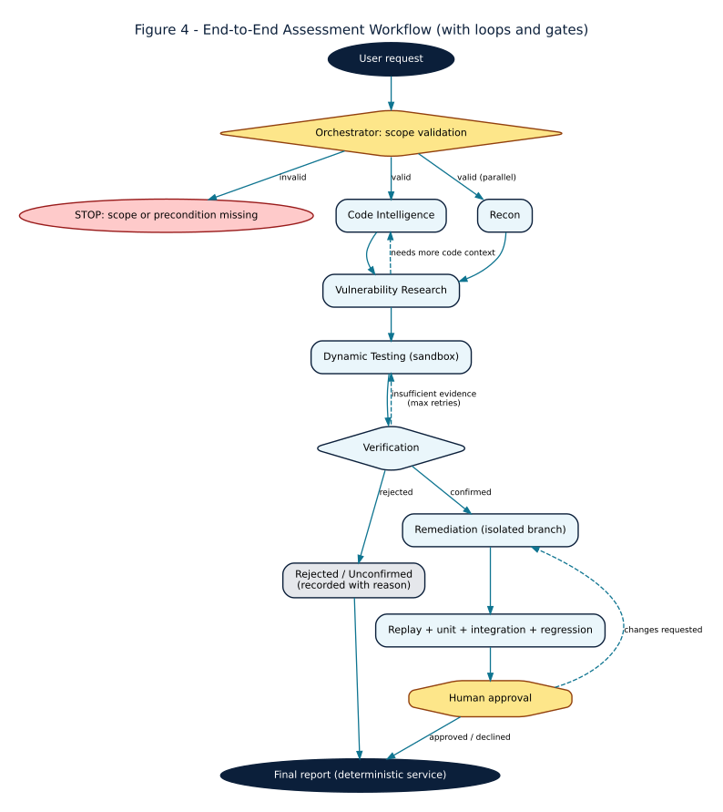

> **اقرأ هذا أولًا (2026-11-21).** هذا الملف تصميم الإصدار الثاني، وليس وصف العملية التي يبدأها `backend/run.py`. التشغيل الفعلي SQLite وواجهة JavaScript عادية، والفحص لا ينفّذ الاختبار الديناميكي ولا التحقق ولا الإصلاح. انظر `AegisTrace_Documentation/00_What_Actually_Runs_AR.md`.

# 1. هوية المشروع ونطاقه

## 1.1 الرؤية

AegisTrace منصة أمن تطبيقات مستقلة تعمل بالذكاء الاصطناعي. تحلّل مستودعات الشيفرة المصدرية والتطبيقات الحيّة وواجهات REST **المصرّح بها صراحةً** فقط، وتنقل الثغرة من فهم الشيفرة حتى إصلاح موثّق يعتمده إنسان.

تجمع المنصة بين ذكاء الشيفرة الساكن، واكتشاف سطح الهجوم، والبحث عن الثغرات بمساعدة الذكاء الاصطناعي، والاختبار الديناميكي، والتحقق القائم على الأدلة، والإصلاح بمساعدة الذكاء الاصطناعي، واختبارات الانحدار الآلية، مع **موافقة بشرية إلزامية** قبل دمج أي إصلاح أو نشره.

AegisTrace ليست ماسحاً يعتمد على مطابقة الأنماط. الماسح يبلّغ عن شيفرة مشبوهة، أمّا AegisTrace فتطرح سؤالاً أقوى: *هل ينتهك التطبيق العامل فعلاً قاعدة أمنية تقول الشيفرة والسياسة إنه ملزم بتطبيقها، وهل نستطيع إعادة إنتاج هذا الانتهاك بأدلة؟*

## 1.2 الفكرة المحورية: التوأم الأمني من الشيفرة إلى السلوك

(Code-to-Behavior Security Twin)

تربط الفكرة الهندسية المحورية ثلاثة تمثيلات للتطبيق نفسه وتبحث عن التناقضات بينها.



| التمثيل | المحتوى | يُنتجه |
|---|---|---|
| **A. الشيفرة** | المسارات، المتحكمات، وسيط المصادقة، فحوص التفويض، نماذج البيانات، عمليات قاعدة البيانات، الاعتماديات، تدفقات البيانات | وكيل ذكاء الشيفرة (Code Intelligence) |
| **B. وقت التشغيل** | طلبات واستجابات HTTP، الهويات والأدوار، حالة التطبيق، تغيّرات حالة قاعدة البيانات | وكيل الاختبار الديناميكي (Dynamic Testing) |
| **C. السياسة** | الصلاحيات المتوقعة، قواعد الملكية، قيود الأدوار، الثوابت الأمنية (Security Invariants) | تُستخرج من الشيفرة أو يصرّح بها المستخدم أو كلاهما |

**المساهمة التقنية (بدقة).** المساهمة ليست في تقنية منفردة؛ فالتحليل الساكن واختبار الهويات المزدوجة ومقارنة قواعد البيانات موجودة أصلاً. المساهمة المقترحة هي **تركيبها تحت عقد واحد**: يُستخرج ثابت أمني مرشّح من الشيفرة، ويُربط بنقطة نهاية محددة، ويُختبر بهويتين أو أكثر، ثم يُحكم عليه بمقارنة حالة قاعدة البيانات قبل الطلب وبعده، فينتج حكم قابل لإعادة الإنتاج ومرتبط بالأدلة. لا ندّعي أن الفكرة غير مسبوقة عالمياً. أمّا هل يحسّن هذا التركيب النتائج فهو **سؤال تجريبي** يجيب عنه تصميم القياس في القسم 11؛ ولا تُذكر أي نتائج مقاسة في هذه الوثيقة.

### المثال التطبيقي (يُستخدم بالاتساق في كل الوثائق)

واجهة برمجية لمتجر إلكتروني. المستخدم A يملك الطلب 100، والمستخدم B يملك الطلب 200. يرسل B الطلب `PATCH /api/v1/orders/100`. تعيد الواجهة `403 Forbidden`، **لكن صف قاعدة البيانات للطلب 100 تغيّر فعلاً.**

1. تُستخرج قاعدة الملكية من الشيفرة أو السياسة المعلنة: *لا يعدّل الطلبَ إلا مالكُه*.
2. تُحدَّد نقطة النهاية `PATCH /api/v1/orders/{order_id}`.
3. تُنفَّذ طلبات مزدوجة بهوية A (المالك) وهوية B (غير المالك).
4. تُلتقط استجابات HTTP.
5. تُؤخذ لقطة لحالة `orders.id = 100` قبل الطلب وبعده.
6. يبيّن محرك فرق الحالة (State-Diff Engine) أن `shipping_address` تغيّر بعد طلب B.
7. يُعاد إنتاج السلوك عدداً محدداً من المرات.
8. تُخزَّن الأدلة كسجلات غير قابلة للتعديل.
9. يُقترح إصلاح على فرع معزول.
10. يُعاد تشغيل الاختبار المزدوج نفسه على النسخة المُصلحة.
11. تُشغَّل اختبارات الانحدار.
12. يوافق إنسان على الدمج أو يرفضه.

الفكرة الجوهرية: الماسح الذي ينظر إلى الاستجابة فقط يرى `403` ولا يبلّغ بشيء، بينما يكشف فرق الحالة العيب الحقيقي.

# 2. المعمارية الثابتة

المعمارية التالية ثابتة، وأي انحراف عنها يتطلب مبرراً تقنياً موثقاً وبيان المفاضلة.

## 2.1 الطبقات السبع للنظام

هذه طبقات معمارية، **وليست** وكلاء ذكاء اصطناعي.



| # | الطبقة | التقنية المقترحة | المسؤولية |
|---|---|---|---|
| 1 | واجهة المستخدم | Next.js، React، TypeScript، React Flow | المشاريع، النطاق، إعداد الفحص، مراقبة الوكلاء، النتائج، عارض الأدلة، رسوم سطح الهجوم والشيفرة، مراجعة الإصلاحات، الموافقات، السجل، القياس |
| 2 | التنسيق (Orchestration) | CrewAI، FastAPI | دورة حياة الوكلاء، توزيع المهام، الحالة، إعادة المحاولة، المهل، معالجة الأخطاء، نقاط الموافقة البشرية |
| 3 | ذكاء الذكاء الاصطناعي | سبعة وكلاء، Groq API | الاستدلال، المخرجات المهيكلة، التحقق من JSON، ميزانيات السياق والرموز، إصدارات المطالبات |
| 4 | محرك الذكاء الأمني | Python، Tree-sitter، NetworkX | محلل الشيفرة، الخريطة الأمنية للمستودع، رسم الشيفرة، مستخرج الثوابت، رسم سطح الهجوم، محرك الهويات المزدوجة، محرك فرق الحالة، ربط الأدلة، توليد الفرضيات، محرك التحقق |
| 5 | المهارات والأدوات | أدوات LangChain، محمّل/موجّه المهارات | استرجاع مهارات Claude-BugHunter، وSemgrep وSchemathesis وHTTPX وPlaywright (اختياري) وTavily |
| 6 | التنفيذ والعزل (Sandbox) | Docker | تشغيل التطبيق معزولاً، التحكم بالشبكة الخارجة، لقطات قاعدة البيانات، بيانات اعتماد مؤقتة، التحقق من الإصلاحات، التنظيف، حدود الموارد، سجلات التدقيق |
| 7 | البيانات والذاكرة | PostgreSQL، pgvector | المشاريع، الفحوص، النتائج، الأدلة، الثوابت، الإصلاحات، بيانات المهارات، الذاكرة |

## 2.2 الوكلاء الرسميون السبعة

عدد الوكلاء سبعة بالضبط. وتوليد التقارير **خدمة حتمية (deterministic)** وليس وكيلاً ثامناً.



| # | الوكيل | المخرج الرئيسي | المسؤولية الأساسية |
|---|---|---|---|
| 1 | المنسّق (Orchestrator) | خطة التقييم ونتيجة التحقق من النطاق | يتحقق من النطاق، يخطط، يسند المهام، يتتبع الحالة، يعالج إعادة المحاولة، ويمنع الإجراءات غير المصرّح بها |
| 2 | ذكاء الشيفرة (Code Intelligence) | الخريطة الأمنية للمستودع والثوابت المرشحة | يحلل Python، يستخرج المسارات والمصادقة والنماذج وتدفقات البيانات، ويبني رسم الشيفرة |
| 3 | الاستطلاع (Recon) | خريطة سطح الهجوم | يكتشف نقاط النهاية داخل النطاق، يقرأ OpenAPI، يحدد التقنيات، ويثريها عبر Tavily |
| 4 | البحث عن الثغرات (Vulnerability Research) | الفرضيات وخطط الاختبار | يحوّل مخرجات الشيفرة والاستطلاع إلى فرضيات قابلة للاختبار ومرتبة الأولوية باستخدام المهارات المسترجعة |
| 5 | الاختبار الديناميكي (Dynamic Testing) | أدلة الاختبارات المنفّذة | ينفّذ اختبارات الهويات المزدوجة داخل العزل ويلتقط الطلبات والاستجابات وفروق الحالة |
| 6 | التحقق (Verification) | مؤكَّد / غير مؤكَّد / مرفوض | يعيد الإنتاج، يتحقق من الأدلة، يفحص انتهاك الثابت، ويقدّر الثقة والخطورة |
| 7 | الإصلاح (Remediation) | الإصلاح ونتائج الإعادة والانحدار | يحدد السبب الجذري، يصلح فرعاً معزولاً، يعيد تشغيل الاستغلال، ويطلب الموافقة البشرية |

## 2.3 مسار التشغيل ليس سلسلة جامدة

الترتيب الاسمي: طلب المستخدم ← المنسّق ← التحقق من النطاق ← ذكاء الشيفرة ← الاستطلاع ← البحث عن الثغرات ← الاختبار الديناميكي ← التحقق ← الإصلاح ← الموافقة البشرية ← التقرير النهائي. أمّا الرسم الفعلي وقت التشغيل ففيه توازٍ وحلقات.



| النمط | الشرط الدقيق | الحد الأقصى |
|---|---|---|
| استطلاع متوازٍ | نجح التحقق من النطاق؛ ويحتاج الاستطلاع إلى بيان النطاق ومواصفات API فقط لا إلى نتائج الشيفرة | يبدأ الاثنان بعد التحقق |
| طلب سياق شيفرة إضافي | تشير فرضية إلى رمز أو مسار أو تدفق غير موجود في الخريطة الأمنية | مرتان لكل فرضية |
| عودة من التحقق إلى الاختبار | الحكم «غير مؤكَّد» لعدم كفاية الدليل وخطة الاختبار تسمح بمتغيرات إضافية | جولتا إعادة اختبار |
| الإصلاح يستوضح من ذكاء الشيفرة | السبب الجذري في شيفرة خارج الملفات المرسومة | مرتا استيضاح |
| توقف المنسّق | نطاق غير صالح، أو العزل غير متاح، أو بيانات اعتماد مطلوبة مفقودة، أو رُصد انتهاك للنطاق | فوري ويُسجَّل في التدقيق |
| إعادة عمل الإصلاح | طلب المراجع البشري تغييرات، أو فشلت الإعادة/الانحدار | 3 محاولات لكل نتيجة |

# 3. الاتفاقيات المشتركة

## 3.1 المعرّفات

كل المعرّفات سلاسل مبهمة ببادئة (يُقترح UUIDv7 لترتيبها زمنياً).

| المعرّف | مثال | المعنى |
|---|---|---|
| `project_id` | `prj_0192f1a0` | المشروع الأعلى |
| `engagement_id` | `eng_0192f1b4` | تقييم مصرّح واحد بنطاقه |
| `scan_id` | `scn_0192f1c9` | تنفيذ واحد لسير العمل |
| `task_id` | `tsk_0192f1d2` | وحدة عمل واحدة لوكيل |
| `agent_run_id` | `run_0192f1e7` | استدعاء واحد لوكيل |
| `finding_id` | `fnd_0192f200` | نتيجة ثغرة |
| `evidence_id` | `evd_0192f21b` | سجل دليل غير قابل للتعديل |
| `correlation_id` | `cor_0192f230` | يتتبع طلباً واحداً عبر كل الوكلاء والسجلات |

## 3.2 قواعد العقود

- يحمل كل عقد الحقل `schema_version` (إصدار دلالي مثل `1.0.0`). الإصدارات الفرعية تضيف حقولاً اختيارية فقط؛ والتغيير الكاسر يرفع الإصدار الرئيسي ويعمل الإصداران جنباً إلى جنب أثناء الترحيل.
- كل الطوابع الزمنية بصيغة ISO 8601 وبالتوقيت العالمي (`2026-11-17T09:30:00Z`).
- حقول الحالة قوائم مغلقة؛ القيم المجهولة تُرفض ولا تُتجاهل.
- تمنع النماذج الحقول الزائدة (`extra="forbid"` في Pydantic) ليفشل خرج النموذج اللغوي المشوّه مبكراً.
- تُتحقق مخرجات الوكيل من المخطط قبل تمريرها. عند الفشل يُمنح الوكيل محاولة إصلاح واحدة مع رسالة الخطأ، وفشل الثانية يجعل المهمة `failed`.
- لا تظهر الأسرار في العقود إطلاقاً. تنتقل بيانات الاعتماد كمراجع (`credential_ref: "cred_buyer_a"`) لا تُحلّ إلا داخل العزل.

# 4. الأمان والنطاق والعزل

يقتصر كل اختبار نشط على أصول مصرّح بها صراحةً، ويُفرض ذلك في الشيفرة لا في المطالبات وحدها.

## 4.1 بيان النطاق (Scope Manifest)

يسرد البيان المضيفين المسموحين، والعناوين الأساسية والطرق المسموحة، والمسارات والعمليات المحظورة، ونافذة الاختبار، والهويات المسموحة. يتحقق المنسّق من: سلامة البنية، ومطابقة كل مضيف مستهدف لإدخال مسموح، وعدم وجود حرف بدل يغطي نطاقات طرف ثالث، وكون البيئة معزولة أو غير إنتاجية معتمدة صراحةً، وتسجيل إقرار التصريح (من ومتى).

## 4.2 الإنفاذ

- **منع الشبكة الخارجة افتراضياً.** يسمح العزل بالتطبيق المختبَر وقاعدة بياناته فقط. استدعاءات Tavily والنموذج اللغوي تنطلق من الخادم الخلفي لا من العزل.
- **كل طلب اختبار صادر يمر ببوابة نطاق** داخل غلاف أداة HTTP (المضيف والمسار والطريقة والمعدل). الطلب المحظور يرفع `ScopeViolation` ويُسجَّل في التدقيق وتتوقف المهمة.
- **لا إجراءات هدّامة مستقلة على الإنتاج.** تُرفض أهداف الإنتاج في النسخة الأولى.
- **حدود الموارد** (المعالج، الذاكرة، الزمن، عدد الطلبات) وحاويات مؤقتة تُنظَّف بعد كل فحص.
- **لا دمج ولا نشر تلقائي.** تبقى الإصلاحات على فرع معزول، والدمج يتطلب موافقة بشرية مسجّلة.
- **المحتوى الخارجي غير موثوق.** نتائج البحث ونصوص المستودع واستجابات HTTP بيانات وليست تعليمات (دفاع ضد حقن المطالبات)، وتُفصل بحدود واضحة وتنص مطالبات النظام على ذلك.

# 5. حدود النسخة الأولى (MVP)

| ضمن النطاق | خارج النطاق صراحةً |
|---|---|
| تطبيقات ويب Python وواجهات REST | المسح الشامل للإنترنت أو أهداف طرف ثالث عشوائية |
| كسر التحكم بالوصول، IDOR، عيوب المصادقة والتفويض، عيوب منطق الأعمال | الاختبار غير المقيّد على الإنتاج |
| المدخلات: مستودع GitHub أو ZIP، OpenAPI أو مسارات مستخرجة، Docker Compose أو تعليمات التشغيل، بيانات اعتماد متعددة الأدوار، بيان النطاق | النشر التلقائي والدمج دون موافقة |
| بيئات التدريب: OWASP Juice Shop وDVWA وتطبيق Python ضعيف عمداً | اختبار تطبيقات الجوال واختبار البنية السحابية الكاملة |
| المخرجات: الخريطة الأمنية، خريطة سطح الهجوم، الفرضيات، النتائج المؤكدة، خطوات إعادة الإنتاج، الأدلة، الخطورة، الإصلاحات، التحقق منها | كل فئات الثغرات؛ وتدريب النماذج |

ملاحظة: Juice Shop (Node.js) وDVWA (PHP) ليسا تطبيقين بلغة Python، فيُستخدمان لأغراض **الاختبار الديناميكي** فقط، ويُتحقق من تحليل الشيفرة على تطبيق Python المخصص.

# 6. تقييم الحزمة التقنية

| التقنية | المسؤولية | النسخة الأولى | الخطر الرئيسي | البديل |
|---|---|---|---|---|
| Groq API | استدلال النماذج اللغوية للوكلاء | مطلوب | تغيّر النماذج المتاحة؛ حدود المعدل | أي مزوّد خلف واجهة محوّل |
| CrewAI | تنسيق الوكلاء | مطلوب (مقترح) | تغيّر الواجهات؛ غموض تدفق التحكم | LangGraph أو آلة حالات بسيطة |
| LangChain | أغلفة الأدوات والمخططات | مطلوب | تغيّر الإصدارات | دوال أدوات مباشرة |
| FastAPI | واجهة الخادم والمهام الخلفية | مطلوب | لا خطر جوهري | Django REST |
| Next.js + TypeScript | لوحة التحكم | مطلوب (المرحلة 6) | تضخم نطاق الواجهة | أي إطار SPA |
| React Flow | عرض الرسوم البيانية | مطلوب (المرحلة 6) | الرسوم الكبيرة تحتاج تقليماً | Cytoscape.js |
| Tree-sitter | أشجار صياغة سريعة متسامحة مع الأخطاء | مطلوب | يعطي الصياغة لا الدلالة | وحدة `ast` في Python |
| Semgrep | تحليل ساكن بالقواعد | اختياري | جودة القواعد والضجيج | CodeQL (أثقل) |
| Schemathesis | توليد اختبارات API من OpenAPI | اختياري | يحتاج مواصفات جيدة | حالات HTTPX يدوية |
| HTTPX | اختبار HTTP برمجي بالهويات | مطلوب | لا خطر جوهري | requests |
| Playwright | مسارات المتصفح | مؤجَّل | ثقيل؛ للمنطق المرتبط بالواجهة فقط | يُستبعد في نسخة REST |
| NetworkX | رسوم الشيفرة والهجوم في الذاكرة | مطلوب | الذاكرة مع المستودعات الضخمة | igraph أو قاعدة رسوم لاحقاً |
| Docker | العزل | مطلوب | العزل بقدر جودة الإعداد | gVisor أو Firecracker لاحقاً |
| PostgreSQL | سجل النظام الرئيسي | مطلوب | لا خطر جوهري | لا بديل مقترح |
| pgvector | تشابه المتجهات داخل Postgres | مطلوب باستخدام محدود | ضبط الفهارس عند التوسع | قاعدة متجهات مستقلة (غير لازمة) |
| Tavily | البحث الأمني الخارجي | مطلوب للاستطلاع | نتائج غير موثوقة؛ التكلفة | موجزات NVD وصفحات الموردين يدوياً |

**Tree-sitter مقابل `ast`.** لشيفرة Python وحدها يعطي `ast` أشجاراً دقيقة لكنه يفشل مع الملفات ذات أخطاء الصياغة. أمّا Tree-sitter فيتسامح مع الملفات الناقصة أو المكسورة ويحافظ على واجهة واحدة إن أُضيفت لغات أخرى. المقترح: Tree-sitter محلل أساسي و`ast` للتحقق المتقاطع في حلّ المزخرفات والاستدعاءات، وفوقهما مستخرجات مسارات خاصة بالأطر (Flask وFastAPI وDjango).

**انضباط الادعاءات.** قدرات المكتبات هنا نابعة من نية التصميم. يجب تأكيد الواجهات والإصدارات وأسماء النماذج من الوثائق الرسمية في المرحلة 1، ومن معايير قبولها خطوة للتحقق من الاعتماديات.

# 7. دمج مهارات Claude-BugHunter

المصدر: `github.com/elementalsouls/Claude-BugHunter`. فُحص محلياً عند الإصدار الفرعي `64410ed`؛ ويعلن المستودع 83 مهارة في `skills/<name>/SKILL.md` وإصدار الحزمة 2.1.0.

**المهارات معرفة لا وكلاء.** يسترجع وكلاء AegisTrace السبعة نصوص المهارات كسياق منهجي. المهارة ليست وكيلاً ثامناً ولا تُنفَّذ كشيفرة.

## 7.1 المحمّل والموجّه

1. **فحص** المستودع المستنسخ وتسجيل رمز الإصدار.
2. **اكتشاف** `skills/*/SKILL.md`.
3. **تحليل** ترويسة YAML (`name` و`description` و`sources` و`report_count` الاختياري) والمتن.
4. **فهرسة** البيانات الوصفية ومقاطع المتن في `skills` و`skill_metadata` (فهرس كلمات مع متجهات pgvector اختيارية).
5. **ربط** كل مهارة بفئة ثغرة ومرحلة.
6. **التوجيه:** عند إعطاء وكيل ومرحلة وفرضية تُختار أصغر مجموعة مهارات (افتراضياً 1 إلى 3) ضمن ميزانية رموز.
7. **التتبع:** تُسجَّل الإسنادات والإصدار عند كل استخدام (`skill_usage_logs`).

لا تُحمَّل كل المهارات في كل مطالبة أبداً.

## 7.2 ربط المهارات بالمراحل (الأسماء مُتحقَّق منها في المستودع)

| المرحلة | الوكيل | المهارات | السبب |
|---|---|---|---|
| تخطيط الاستطلاع | Recon | `web2-recon`، `recon-scope-triage` | منهجية الاستطلاع وفصل الأصول الحقيقية عن ضجيج تصادم الأسماء. يستخدم AegisTrace المنهجية للأصول ضمن النطاق فقط دون تعداد النطاقات الفرعية بالقوة |
| المنهج العام | Vulnerability Research | `bb-methodology` | سير عمل الصيد غير الخطي والتفكير بالشذوذ |
| التحكم بالوصول | Vulnerability Research وDynamic Testing | `hunt-idor` | أنماط IDOR ونقاط النهاية الحرجة وأفكار الاختبار |
| المصادقة والتفويض | Vulnerability Research | `hunt-auth-bypass`، `hunt-session`، `hunt-jwt-crypto`، `hunt-mfa-bypass`، `hunt-forgot-password` | عيوب مسارات المصادقة؛ وتزوير JWT تملكه `hunt-jwt-crypto` |
| سلوك API | Vulnerability Research | `hunt-api-misconfig`، `hunt-shadow-api`، `hunt-spa-api` | الإسناد الجماعي، الإصدارات غير الموثقة، سطح API المخفي |
| منطق الأعمال | Vulnerability Research | `hunt-business-logic`، `hunt-race-condition` | التلاعب بالأسعار وعيوب القسائم والسباق |
| معالجة الفشل | Vulnerability Research | `hunt-exceptional-conditions` | الأخطاء المسهبة والفشل المفتوح |
| الفرز والتحقق | Verification | `triage-validation` | بوابات التحقق ومنطق الخطورة |
| نظافة الأدلة | Dynamic Testing وVerification | `evidence-hygiene` | إخفاء ملفات الارتباط والبيانات الشخصية في الأدلة المخزنة |
| التقارير | خدمة التقارير (حتمية) | `report-writing` | بنية التقرير وصياغة الأثر |
| الإصلاح | Remediation | *(لا يوجد)* | لا يحوي المستودع مهارة إصلاح مخصصة، لذا تأتي معرفة الإصلاح من مدوّنة AegisTrace المنتقاة |

## 7.3 الترخيص والإسناد

| العنصر | ما وُجد |
|---|---|
| `LICENSE` | رخصة MIT، حقوق النشر (c) 2026 Sachin Sharma، وتنطبق على الشيفرة |
| `LICENSE-CONTENT` | رخصة Creative Commons Attribution 4.0 (CC BY 4.0)، وتنطبق على التوثيق ومحتوى المهارات |
| `NOTICE` | يبيّن الترخيص المزدوج، ويشير إلى مهارات مجتمعية من مصادر أصلية تحتفظ برخصها |
| `docs/credits.md` | يذكر مواد مضمّنة من `shuvonsec/claude-bug-bounty` (MIT) ومهارات أسهم بها المجتمع |

**النتائج.** لا يجوز افتراض رخصة واحدة لكل الملفات. إذا أعاد AegisTrace توزيع نصوص المهارات فعليه الحفاظ على إسناد CC BY 4.0 (النسبة ورابط الرخصة وبيان التعديلات) والاحتفاظ بإشعارات MIT للشيفرة والأجزاء المضمّنة. الخيار الافتراضي الأكثر أماناً: عدم تضمين نصوص المهارات، بل استنساخ المستودع عند إصدار محدد وقت التثبيت، وتخزين البيانات الوصفية ومقتطفات قصيرة مع الإسناد، وعرض `sources` لكل مهارة ورمز الإصدار في الواجهة. يوصى بمراجعة قانونية قبل أي إعادة توزيع. هذا إرشاد هندسي وليس استشارة قانونية.

# 8. سياسة دمج Tavily

مُتحقَّق منه من مرجع Tavily الرسمي: `POST https://api.tavily.com/search`، والترويسة `Authorization: Bearer <مفتاح API>`، والحقل الإلزامي `query`، والحقل الاختياري `search_depth` (القيم `basic` و`fast` و`ultra-fast` بتكلفة رصيد واحد، و`advanced` برصيدين)، إضافة إلى معاملات مثل `include_answer` و`chunks_per_source` و`exact_match` و`max_age_hours`. تتضمن النتائج `title` و`url` و`content` و`score`. تعرض بعض صفحات Tavily الأقدم حقل `api_key` في المتن وحداً ثابتاً للمعدل؛ تُعامل على أنها قديمة وتُراجع المرجع الحالي عند التنفيذ. التكامل مع LangChain عبر الحزمة `langchain-tavily` التي تقرأ `TAVILY_API_KEY`.

| المرحلة | السياسة |
|---|---|
| الاستطلاع | **مفعّل افتراضياً.** إرشادات الأطر وCVE ونشرات الموردين للتقنيات المحددة |
| البحث عن الثغرات | **اختياري** عند الطلب لإرفاق مراجع بالفرضية |
| التحقق | **معطّل افتراضياً.** يجب أن يستند التحقق إلى أدلة أُعيد إنتاجها لا إلى نتائج البحث |
| الإصلاح | **اختياري** للاستشهاد بإرشادات الإصلاح الرسمية، ويجب أن ينجح الإصلاح في الاختبارات مع ذلك |

**القواعد.** يأتي المفتاح من البيئة لا من الشيفرة. النتائج نصوص غير موثوقة: تُزال التكرارات بالعنوان القياسي، وتُفضَّل النطاقات الرسمية (الموردون وNVD وOWASP)، ويُسجَّل العنوان ووقت الجلب والاستعلام لكل مرجع، وتُحدّ النتائج والتكلفة لكل فحص، وتُخزَّن مؤقتاً حسب الاستعلام بمدة صلاحية قابلة للضبط، ويُتراجع عند حدود المعدل. لا تحل Tavily محل Semgrep أو Schemathesis أو HTTPX أو Playwright، ولا تثبت ثغرة، ولا تبرّر اختبار هدف خارج النطاق.

# 9. ملخص البيانات والذاكرة

| نوع الذاكرة | النطاق | المخزن | العمر |
|---|---|---|---|
| العمل | المهمة الحالية | ذاكرة العملية / صف المهمة | المهمة |
| المشروع | بنية المستودع والمسارات والثوابت | جداول PostgreSQL | المشروع |
| التقييم | النطاق والهويات والنتائج والأدلة | PostgreSQL | التقييم ثم سياسة الاحتفاظ |
| المعرفة | بيانات المهارات والأنماط | PostgreSQL + pgvector | بإصدارات |
| الإصلاح | الإصلاحات والأسباب الجذرية والنتائج | PostgreSQL + pgvector | المشروع |

سجلات الأدلة للإلحاق فقط ومجزّأة بـ SHA-256 عند الكتابة. لا تُخزَّن الأسرار نصاً صريحاً في أي نوع ذاكرة؛ تُخزَّن المراجع والبيانات المشفّرة فقط. الاسترجاع هجين: ترشيح بالبيانات الوصفية، ثم مطابقة الكلمات، ثم تشابه المتجهات، ثم الترتيب والقصّ ضمن ميزانية السياق. المخطط الكامل في وثيقة الذاكرة وقواعد البيانات المستقلة وفي ملحق SQL.

# 10. مراحل التطوير وترتيب البناء

| المرحلة | الاسم | المخرج الرئيسي |
|---|---|---|
| 1 | الأساس ودمج المهارات | الهيكل، التحقق من النطاق، منسّق أدنى، نموذج استرجاع المهارات، أساس قاعدة البيانات |
| 2 | ذكاء الشيفرة | الخريطة الأمنية، رسم الشيفرة، الثوابت المرشحة |
| 3 | الاستطلاع والاختبار الديناميكي | خريطة سطح الهجوم، اختبارات الهويات المزدوجة، محرك فرق الحالة |
| 4 | البحث والتحقق | الفرضيات، خطط الاختبار، النتائج المؤكدة |
| 5 | الإصلاح بالذكاء الاصطناعي | الإصلاحات، الإعادة، الانحدار، سير الموافقة |
| 6 | اللوحة والتكامل والقياس | نسخة أولى متكاملة، تقرير القياس |

**ترتيب البناء مقابل ترتيب التشغيل.** الترتيب المقترح: الخطوة 0 للبنية المشتركة والمنسّق الأدنى، ثم ذكاء الشيفرة أولاً. نُبقي ذكاء الشيفرة أولاً لأن كل وكيل لاحق يستهلك خريطته الأمنية وثوابته. ونقترح تعديلاً واحداً: **بناء الاختبار الديناميكي ومحرك فرق الحالة قبل وكيل البحث عن الثغرات.** السبب أن مشغّل الهويات المزدوجة يمكن تجربته بخطط اختبار يدوية على التطبيق الضعيف المخصص، فتُخفَّض مخاطر أصعب مكوّن مبكراً، ثم يولّد وكيل البحث خططاً لمحرك يعمل أصلاً. ويمكن تقدّم الاستطلاع بالتوازي مع الاختبار الديناميكي. يلي ذلك التحقق ثم الإصلاح ثم تكامل المنسّق الكامل ثم اللوحة والقياس. ترتيب البناء مستقل عن ترتيب التشغيل.

# 11. تصميم التقييم

| الذراع | الإعداد |
|---|---|
| A | تحليل ساكن فقط |
| B | ساكن مع اختبار ديناميكي |
| C | AegisTrace كاملة: ساكن، ديناميكي، ثوابت، هويات مزدوجة، فرق حالة، تحقق، إصلاح |

المقاييس: الدقة (Precision)، الاستدعاء (Recall)، معدل الإيجابيات الكاذبة، معدل إعادة الإنتاج، معدل نجاح الإصلاح، معدل الانحدار، زمن التأكيد، تكلفة API، استهلاك الرموز، زمن التنفيذ، انتهاكات النطاق (الهدف: صفر).

الأهداف: تطبيق Python ضعيف مخصص (أساسي، وحقيقة الأساس من وضعنا)، إضافة إلى Juice Shop وDVWA (ديناميكي فقط). حقيقة الأساس قائمة موسومة بالثغرات المعروفة لكل هدف. يُشغَّل كل ذراع على الأهداف نفسها وبالميزانية نفسها عدة مرات لاحتواء تباين النماذج اللغوية، وتُعرض النتائج بالمتوسط والتشتت.

**حالة النتائج:** لا توجد نتائج مقاسة. كل ما سبق منهج مقترح، والنتائج المتوقعة فرضيات (مثل أن الذراع C يقلل الإيجابيات الكاذبة في أخطاء حالة التحكم بالوصول مقارنةً بالذراع A) تؤكدها القياسات أو تنفيها.

# 12. هيكل المستودع

```text
aegistrace/
  backend/          FastAPI app, routers, dependency wiring (no business logic)
  orchestration/    CrewAI crew/flow definitions, state machine, retry policy
  agents/           Seven agent packages: prompts, tools binding, schemas usage
  schemas/          Pydantic models and exported JSON Schemas (single source of truth)
  security_engine/  parser/, graph/, invariants/, identity_tests/, state_diff/, verification/
  skills/           loader, router, index (no vendored skill text by default)
  tools/            LangChain tool wrappers (httpx_scoped, semgrep, schemathesis, tavily)
  sandbox/          Docker compose templates, scope gate, snapshot helpers
  database/         migrations, DDL, repositories
  memory/           retrieval, ranking, budgeting
  frontend/         Next.js app
  tests/            unit, integration, contract, e2e
  benchmarks/       targets, ground truth, runners, reports
  docs/             this documentation package
  scripts/          dev and CI helpers
  infrastructure/   Docker, CI, deployment manifests
```

القواعد: لا تعتمد `schemas/` على أي حزمة أخرى؛ ويجوز أن تعتمد `agents/` على `schemas/` و`tools/` و`skills/` و`security_engine/`؛ ولا يحوي `backend/` منطق الوكلاء؛ ولا تُحفظ الأسرار في المستودع.

# 13. القيود المعروفة والبنود المفتوحة

- تتغير النماذج المتاحة في Groq وحدودها بمرور الوقت. يُختار النموذج عبر الإعداد (`GROQ_MODEL`) ويُتحقق منه من وثائق المزوّد عند النشر؛ ولا تذكر هذه الوثيقة اسم نموذج عمداً.
- يجب إعادة التحقق من تفاصيل CrewAI وLangChain وSemgrep وSchemathesis وPlaywright وpgvector وTree-sitter وTavily من الوثائق الرسمية عند التنفيذ؛ ولم يُفحص لهذه النسخة سوى Tavily Search ومستودع Claude-BugHunter.
- تغطي رسوم هذه النسخة الطبقات والوكلاء والتوأم الأمني وسير العمل. أمّا بقية قائمة الرسوم فتُنتَج مع وثائقها. وتستخدم الرسوم التسميات التقنية بالإنجليزية في النسختين العربية والإنجليزية.
- يحتاج ترخيص المهارات إلى تأكيد قانوني قبل إعادة التوزيع.

# 14. المراجع

- مستودع Claude-BugHunter: https://github.com/elementalsouls/Claude-BugHunter
- وثائق Tavily: https://docs.tavily.com/
- مرجع Tavily Search API: https://docs.tavily.com/documentation/api-reference/endpoint/search
- وثائق Groq: https://console.groq.com/docs
- وثائق CrewAI: https://docs.crewai.com/
- وثائق LangChain: https://docs.langchain.com/
- pgvector: https://github.com/pgvector/pgvector
- Tree-sitter: https://tree-sitter.github.io/tree-sitter/
- Semgrep: https://semgrep.dev/docs/
- Schemathesis: https://schemathesis.readthedocs.io/
- OWASP API Security Top 10: https://owasp.org/API-Security/
