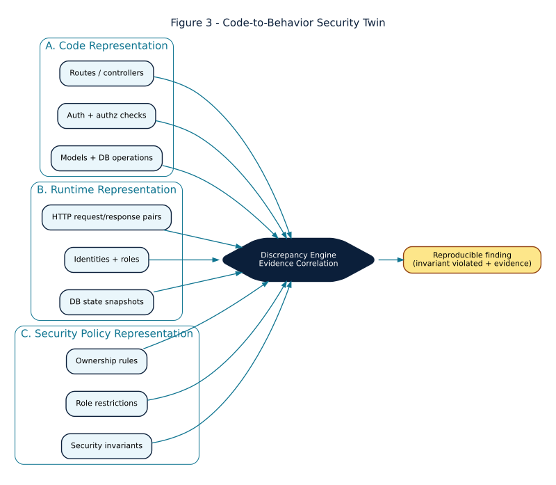
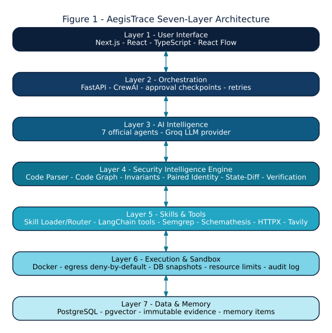
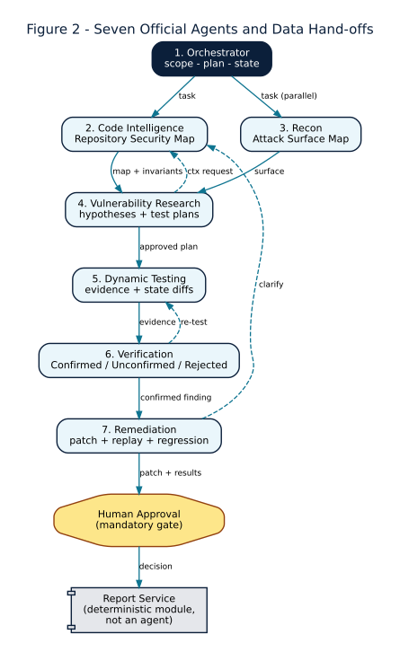
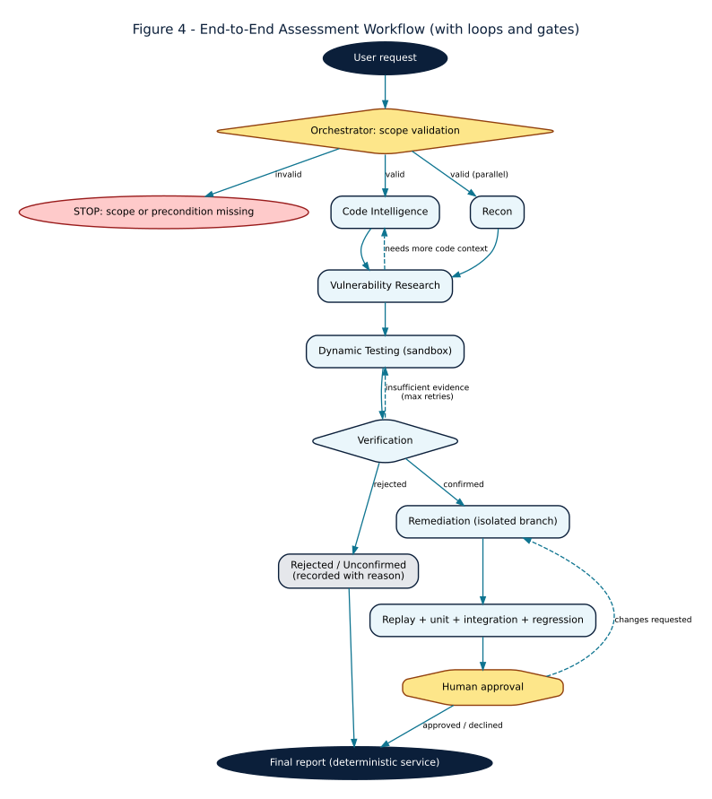

> **Read this first (2026-11-21).** This file is the Edition 2 design, not a record of the process started by `backend/run.py`. The running system is SQLite plus the vanilla JavaScript UI, and a scan does not execute dynamic testing, verification, or remediation. See `AegisTrace_Documentation/00_What_Actually_Runs.md`.

# 1. Project Identity and Scope

## 1.1 Vision

AegisTrace is an autonomous, AI-assisted application security platform. It analyzes source code repositories and **explicitly authorized** live applications and REST APIs, and it moves a finding all the way from code understanding to a verified, human-approved fix.

It combines static code intelligence, attack surface discovery, AI-assisted vulnerability research, dynamic testing, evidence-based verification, AI-assisted remediation, automated regression testing, and a mandatory human approval step before any fix is merged or deployed.

AegisTrace is deliberately **not** a pattern-matching scanner. A scanner reports suspicious code. AegisTrace asks a stronger question: *does the running application actually violate a security rule that the code and policy say it must enforce, and can we reproduce that violation with evidence?*

## 1.2 Core Concept: the Code-to-Behavior Security Twin

The central engineering idea connects three representations of the same application and looks for discrepancies between them.



| Representation | Contents | Produced by |
|---|---|---|
| **A. Code** | Routes, controllers, authentication middleware, authorization checks, data models, database operations, dependencies, data flows | Code Intelligence Agent |
| **B. Runtime** | HTTP requests and responses, identities and roles, application state, database state changes | Dynamic Testing Agent |
| **C. Policy** | Expected access permissions, ownership rules, role restrictions, security invariants | Extracted from code, declared by the user, or both |

**Technical contribution (stated precisely).** The contribution is not any single technique; static analysis, paired-identity testing and database diffing each exist already. The proposed contribution is their *composition under one contract*: a candidate invariant is extracted from code, bound to a concrete endpoint, exercised with two or more identities, and judged against a before/after database state diff, producing a reproducible, evidence-linked verdict. We do not claim this is globally unprecedented. Whether the composition improves results is an **empirical question** answered by the benchmark design in Section 11; no results are claimed in this document.

### Worked example (used consistently across all documents)

An e-commerce API. User A owns Order 100; User B owns Order 200. User B sends `PATCH /api/v1/orders/100`. The API returns `403 Forbidden`, **but the database row for Order 100 has changed.**

1. The ownership rule is extracted from code or declared policy: *an order may only be modified by its owner*.
2. The endpoint `PATCH /api/v1/orders/{order_id}` is identified.
3. Paired requests are executed with identity A (owner) and identity B (non-owner).
4. HTTP responses are captured.
5. Database state for `orders.id = 100` is snapshotted before and after.
6. The State-Diff Engine reports that `shipping_address` changed after B's request.
7. The behavior is reproduced a configured number of times.
8. Evidence is stored as immutable records.
9. A patch is proposed on an isolated branch.
10. The same paired test is replayed against the patched build.
11. Regression tests run.
12. A human approves or rejects the merge.

The key insight: a response-only scanner would see `403` and report nothing. The state diff exposes the real defect.

# 2. Fixed Architecture

The architecture below is fixed. Any deviation requires a documented technical reason and trade-off.

## 2.1 Seven System Layers

These are architectural layers, **not** AI agents.



| # | Layer | Recommended technology | Responsibility |
|---|---|---|---|
| 1 | User Interface | Next.js, React, TypeScript, React Flow | Projects, scope, scan config, agent monitoring, findings, evidence viewer, attack-surface and code graphs, patch review, approvals, history, benchmarks |
| 2 | Orchestration | CrewAI, FastAPI | Agent lifecycle, task distribution, state, retries, timeouts, error handling, human approval checkpoints |
| 3 | AI Intelligence | Seven agents, Groq API | Reasoning, structured output, JSON validation, context and token budgets, prompt versioning |
| 4 | Security Intelligence Engine | Python, Tree-sitter, NetworkX | Code Parser, Repository Security Map, Code Graph, Invariant Extractor, Attack Surface Graph, Paired Identity Test Engine, State-Diff Engine, Evidence Correlation, Hypothesis Engine, Verification Engine |
| 5 | Skills and Tools | LangChain tools, Skill Loader/Router | Claude-BugHunter skill retrieval, Semgrep, Schemathesis, HTTPX, Playwright (optional), Tavily |
| 6 | Execution and Sandbox | Docker | Isolated app execution, egress control, DB snapshots, temporary credentials, patch validation, cleanup, resource limits, audit logs |
| 7 | Data and Memory | PostgreSQL, pgvector | Projects, scans, findings, evidence, invariants, patches, skill metadata, memory |

## 2.2 Seven Official Agents

There are exactly seven agents. Report generation is a **deterministic service**, not an eighth agent.



| # | Agent | Primary output | Key responsibility |
|---|---|---|---|
| 1 | Orchestrator | Engagement plan, scope validation result | Validates scope, plans, assigns, tracks state, handles retries, blocks unauthorized actions |
| 2 | Code Intelligence | Repository Security Map, candidate invariants | Parses Python, extracts routes/auth/models/data flows, builds the code graph |
| 3 | Recon | Attack Surface Map | Discovers in-scope endpoints, ingests OpenAPI, fingerprints technology, enriches via Tavily |
| 4 | Vulnerability Research | Hypotheses and test plans | Turns code and recon output into testable, prioritized hypotheses using retrieved skills |
| 5 | Dynamic Testing | Executed test evidence | Runs paired-identity tests in the sandbox, captures requests, responses and state diffs |
| 6 | Verification | Confirmed / Unconfirmed / Rejected | Reproduces, validates evidence, checks invariant violation, scores confidence and severity |
| 7 | Remediation | Patch, replay and regression results | Finds root cause, patches an isolated branch, replays the exploit, requests human approval |

## 2.3 Runtime Workflow Is Not a Rigid Chain

The nominal order is: User Request → Orchestrator → Scope Validation → Code Intelligence → Recon → Vulnerability Research → Dynamic Testing → Verification → Remediation → Human Approval → Final Report. The actual runtime graph has parallelism and loops.



| Pattern | Exact condition | Bound |
|---|---|---|
| Parallel Recon | Scope validation passes; Recon needs only the scope manifest and API spec, not code results | Both start after validation |
| Research requests more code context | A hypothesis references a symbol, route or flow absent from the Repository Security Map | Max 2 requests per hypothesis |
| Verification returns for more testing | Verdict is *Unconfirmed* because evidence is insufficient and the test plan allows more variants | Max 2 re-test rounds |
| Remediation asks Code Intelligence | Root cause involves code outside the files already mapped | Max 2 clarifications |
| Orchestrator halts | Scope invalid, sandbox unavailable, required credentials missing, or a scope violation is detected | Immediate; audit-logged |
| Patch rework | Human reviewer requests changes, or replay/regression fails | Max 3 patch attempts per finding |

# 3. Shared Conventions

## 3.1 Identifiers

All identifiers are opaque, prefixed strings (UUIDv7 recommended, so they sort by creation time).

| Identifier | Example | Meaning |
|---|---|---|
| `project_id` | `prj_0192f1a0` | Top-level project |
| `engagement_id` | `eng_0192f1b4` | One authorized assessment with its scope |
| `scan_id` | `scn_0192f1c9` | One execution of a workflow |
| `task_id` | `tsk_0192f1d2` | One unit of agent work |
| `agent_run_id` | `run_0192f1e7` | One agent invocation |
| `finding_id` | `fnd_0192f200` | A vulnerability finding |
| `evidence_id` | `evd_0192f21b` | An immutable evidence record |
| `correlation_id` | `cor_0192f230` | Traces one request across all agents and logs |

## 3.2 Contract rules

- Every contract carries `schema_version` (semantic version, e.g. `1.0.0`). Minor versions add optional fields only; breaking changes bump the major version and run side by side during migration.
- All timestamps are ISO 8601 UTC (`2026-11-17T09:30:00Z`).
- Status fields are closed enumerations; unknown values are rejected, not ignored.
- Models forbid extra fields (`extra="forbid"` in Pydantic) so malformed LLM output fails fast.
- Agent outputs are validated against the schema before they are handed on. On a validation failure the agent gets one repair attempt with the validation error; a second failure marks the task `failed`.
- Secrets never appear in contracts. Credentials travel as references (`credential_ref: "cred_buyer_a"`) resolved only inside the sandbox.

# 4. Safety, Scope and Sandbox

All active testing is restricted to explicitly authorized assets. This is enforced in code, not only in prompts.

*A dedicated sandbox and scope-gate diagram is part of the remaining diagram inventory (see Section 13).*

## 4.1 Scope Manifest

A scope manifest lists allowed hosts, allowed base URLs and methods, forbidden paths and operations, the testing window, and the identities permitted. Orchestrator validation checks: manifest well-formed, every target host matches an allowed entry, no wildcard covers third-party domains, the environment is a sandbox or explicitly approved non-production system, and an authorization attestation (who, when) is recorded.

## 4.2 Enforcement

- **Egress deny by default.** The sandbox network allows only the application under test and its database. Tavily and LLM calls originate from the backend, never from the sandbox.
- **Every outbound test request passes a scope gate** in the HTTP tool wrapper (host, path, method, rate). A blocked request raises a `ScopeViolation`, is audit-logged, and halts the task.
- **No destructive autonomous actions against production.** Production targets are rejected in the MVP.
- **Resource limits** (CPU, memory, wall-clock, request budget) and ephemeral containers with cleanup after each scan.
- **No automatic merge or deploy.** Patches live on an isolated branch; merging needs a recorded human approval.
- **External content is untrusted.** Web search results, repository text and HTTP responses are data, never instructions (prompt-injection defense). They are delimited and the agent system prompts state this explicitly.

# 5. MVP Boundaries

| In scope | Explicitly out of scope |
|---|---|
| Python web applications and REST APIs | Internet-wide or arbitrary third-party scanning |
| Broken Access Control, IDOR, Authentication/Authorization flaws, Business Logic flaws | Unrestricted production testing |
| Inputs: GitHub repo or ZIP, OpenAPI or extracted routes, Docker Compose or startup instructions, multi-role test credentials, scope manifest | Automatic deployment, unapproved merging |
| Training targets: OWASP Juice Shop, DVWA, a custom vulnerable Python app | Mobile app testing, full cloud infrastructure testing |
| Outputs: Security Map, Attack Surface Map, hypotheses, confirmed findings, reproduction steps, evidence, severity, patches, patch verification | Every vulnerability class; model fine-tuning |

Note: Juice Shop (Node.js) and DVWA (PHP) are not Python applications. They are used as **dynamic-testing** targets only. Code-level analysis is validated on the custom Python application.

# 6. Technology Stack Evaluation

| Technology | Responsibility | MVP | Main risk | Alternative |
|---|---|---|---|---|
| Groq API | LLM inference for agents | Required | Model availability changes; rate limits | Any provider behind an adapter interface |
| CrewAI | Agent orchestration | Required (proposal) | Framework API churn; opaque control flow | LangGraph, or a plain state machine |
| LangChain | Tool wrappers and schemas | Required | Version churn | Direct function tools |
| FastAPI | Backend API, background tasks | Required | None significant | Django REST |
| Next.js + TypeScript | Dashboard | Required (Phase 6) | Scope creep in UI | Any SPA framework |
| React Flow | Graph visualization | Required (Phase 6) | Large graphs need pruning | Cytoscape.js |
| Tree-sitter | Fast, error-tolerant syntax trees | Required | Gives syntax only, no semantic resolution | Python `ast` |
| Semgrep | Rule-based static analysis | Optional in MVP | Rule quality; noise | CodeQL (heavier) |
| Schemathesis | OpenAPI-driven API test generation | Optional in MVP | Needs a good spec | Hand-written HTTPX cases |
| HTTPX | Scripted HTTP testing with identities | Required | None significant | requests |
| Playwright | Browser flows | Deferred | Heavy; only for UI-bound logic | Skip for REST-only MVP |
| NetworkX | In-memory code and attack graphs | Required | Memory on very large repos | igraph, or a graph DB later |
| Docker | Sandbox | Required | Isolation is only as good as configuration | gVisor, Firecracker later |
| PostgreSQL | System of record | Required | None significant | none proposed |
| pgvector | Embedding similarity inside Postgres | Required, narrow use | Index tuning at scale | Dedicated vector DB (not needed at MVP scale) |
| Tavily | External security research | Required for Recon | Untrusted results; cost | Manual advisory feeds (NVD, vendor pages) |

**Tree-sitter versus Python `ast`.** For Python-only MVP code, the standard `ast` module gives exact, semantic-friendly trees but fails on files with syntax errors. Tree-sitter tolerates partial or broken files and keeps one interface if other languages are added. Proposal: use Tree-sitter as the primary parser and `ast` as a cross-check for decorator and call resolution; framework-specific route extractors (Flask, FastAPI, Django) sit on top of both.

**Claim discipline.** Library capabilities listed here come from our design intent. Exact APIs, versions and model names must be confirmed against official documentation during Phase 1; the Phase 1 acceptance criteria include a dependency verification step.

# 7. Claude-BugHunter Skills Integration

Source: `github.com/elementalsouls/Claude-BugHunter`. Inspected locally at commit `64410ed`; the repository declares 83 skills in `skills/<name>/SKILL.md` and package version 2.1.0.

**Skills are knowledge, not agents.** AegisTrace's seven agents retrieve and read skill text as methodology context. A skill is never an eighth agent and is never executed as code.

## 7.1 Loader and Router

1. **Inspect** the cloned repository and record the commit hash.
2. **Discover** `skills/*/SKILL.md`.
3. **Parse** YAML frontmatter (`name`, `description`, `sources`, optional `report_count`) and the body.
4. **Index** metadata and body chunks into `skills` and `skill_metadata` (keyword index plus optional pgvector embeddings).
5. **Map** each skill to a vulnerability category and a phase.
6. **Route**: given an agent, phase and hypothesis, select the smallest set of skills (default: 1-3) under a token budget.
7. **Track** attribution and version on every use (`skill_usage_logs`).

Never load every skill into every prompt.

## 7.2 Skill-to-Phase Mapping (names verified in the repository)

| Phase | Agent | Skills | Why |
|---|---|---|---|
| Recon planning | Recon | `web2-recon`, `recon-scope-triage` | Recon methodology; separating real assets from namespace-collision noise. AegisTrace uses only the methodology for in-scope assets, not subdomain brute-forcing |
| Overall method | Vulnerability Research | `bb-methodology` | Non-linear hunting workflow and anomaly thinking |
| Access control | Vulnerability Research, Dynamic Testing | `hunt-idor` | IDOR patterns, crown-jewel endpoints, test ideas |
| Authentication / authorization | Vulnerability Research | `hunt-auth-bypass`, `hunt-session`, `hunt-jwt-crypto`, `hunt-mfa-bypass`, `hunt-forgot-password` | Auth flow flaws; JWT forgery owned by `hunt-jwt-crypto` |
| API behavior | Vulnerability Research | `hunt-api-misconfig`, `hunt-shadow-api`, `hunt-spa-api` | Mass assignment, undocumented versions, hidden API surface |
| Business logic | Vulnerability Research | `hunt-business-logic`, `hunt-race-condition` | Price tampering, coupon/race flaws |
| Failure handling | Vulnerability Research | `hunt-exceptional-conditions` | Verbose errors and fail-open behavior |
| Triage and validation | Verification | `triage-validation` | Validation gates and severity reasoning |
| Evidence hygiene | Dynamic Testing, Verification | `evidence-hygiene` | Cookie and PII redaction in stored evidence |
| Reporting | Report service (deterministic) | `report-writing` | Report structure and impact wording |
| Remediation | Remediation | *(none)* | The repository has no dedicated remediation skill. Remediation knowledge must come from AegisTrace's own curated corpus |

## 7.3 Licensing and Attribution

| Item | Finding |
|---|---|
| `LICENSE` | MIT License, Copyright (c) 2026 Sachin Sharma, applies to code |
| `LICENSE-CONTENT` | Creative Commons Attribution 4.0 International (CC BY 4.0), applies to documentation and skill content |
| `NOTICE` | States dual licensing; notes references to upstream community skills that keep their original licenses |
| `docs/credits.md` | Reports vendored material from `shuvonsec/claude-bug-bounty` (MIT) and community-contributed skills |

**Consequences.** Do not assume one license for every file. If AegisTrace redistributes skill text, it must keep CC BY 4.0 attribution (credit, license link, note of changes) and preserve MIT notices for code and vendored parts. Safest default proposal: do not bundle skill text; clone at a pinned commit at install time, store only metadata and short excerpts with attribution, and display the per-skill `sources` and commit hash in the UI. Legal review is recommended before any redistribution. This is engineering guidance, not legal advice.

# 8. Tavily Integration Policy

Verified from the official Tavily API reference: `POST https://api.tavily.com/search`, header `Authorization: Bearer <API key>`, required body field `query`, optional `search_depth` (`basic`, `fast`, `ultra-fast` cost 1 credit; `advanced` costs 2), plus parameters such as `include_answer`, `chunks_per_source`, `exact_match` and `max_age_hours`. Results include `title`, `url`, `content` and `score`. Some older Tavily pages show an `api_key` body field and a fixed rate limit; treat those as outdated and re-check the current reference at implementation time. The LangChain integration is the `langchain-tavily` package, which reads `TAVILY_API_KEY`.

| Stage | Policy |
|---|---|
| Recon | **Default on.** Framework advisories, CVE and vendor bulletins for fingerprinted technologies |
| Vulnerability Research | **Optional**, on demand, to attach references to a hypothesis |
| Verification | **Off by default.** Verification must rest on reproduced evidence, never on search results |
| Remediation | **Optional**, to cite official fix guidance; the fix still must pass tests |

**Rules.** The key comes from the environment, never source code. Results are untrusted text: deduplicate by canonical URL, prefer official domains (vendor, NVD, OWASP), record the URL, retrieval time and query for every reference, cap results and cost per scan, cache by query for a configurable TTL, and back off on rate-limit responses. Tavily never replaces Semgrep, Schemathesis, HTTPX or Playwright, never proves a vulnerability, and never justifies testing an out-of-scope target.

# 9. Data and Memory Summary

| Memory type | Scope | Store | Lifetime |
|---|---|---|---|
| Working | Current task | Process memory / task row | Task |
| Project | Repo structure, routes, invariants | PostgreSQL tables | Project |
| Engagement | Scope, identities, findings, evidence | PostgreSQL | Engagement, then retention policy |
| Knowledge | Skill metadata, patterns | PostgreSQL + pgvector | Versioned |
| Remediation | Patches, root causes, outcomes | PostgreSQL + pgvector | Project |

Evidence records are append-only and hashed (SHA-256) at write time. Secrets are never stored in plaintext in any memory type; only references and encrypted blobs. Retrieval is hybrid: metadata filter, then keyword match, then vector similarity, then rank and trim to a context budget. The full schema is in the separate Memory and Database document and in the SQL appendix.

# 10. Development Phases and Build Order

| Phase | Name | Main deliverable |
|---|---|---|
| 1 | Foundation and Skill Integration | Skeleton, scope validation, minimal Orchestrator, skill retrieval prototype, DB foundation |
| 2 | Code Intelligence | Repository Security Map, Code Graph, candidate invariants |
| 3 | Recon and Dynamic Testing | Attack Surface Map, paired-identity tests, State-Diff Engine |
| 4 | Research and Verification | Hypotheses, test plans, confirmed findings |
| 5 | AI Remediation | Patches, replay, regression, approval workflow |
| 6 | Dashboard, Integration and Benchmarking | Integrated MVP, benchmark report |

**Build order versus runtime order.** The recommended build order is Step 0 shared infrastructure and minimal Orchestrator, then Code Intelligence first. We keep Code Intelligence first because every later agent consumes its Repository Security Map and invariants. One refinement is proposed: **build Dynamic Testing and the State-Diff Engine before the Vulnerability Research agent.** Reason: the paired-identity runner can be exercised with hand-written test plans against the custom vulnerable app, which de-risks the hardest component early; Research then generates plans for an engine that already works. Recon can proceed in parallel with Dynamic Testing. Verification follows Dynamic Testing, then Remediation, then full Orchestrator integration, then dashboard and benchmarks. Build order is independent of runtime order.

# 11. Evaluation Design

| Arm | Configuration |
|---|---|
| A | Static analysis only |
| B | Static plus dynamic testing |
| C | Full AegisTrace: static, dynamic, invariants, paired identity, state diff, verification, remediation |

Metrics: precision, recall, false-positive rate, reproduction rate, patch success rate, regression rate, time to confirm, API cost, token consumption, execution time, scope violations (target: zero).

Targets: custom vulnerable Python app (primary, ground truth seeded by us), plus Juice Shop and DVWA (dynamic only). Ground truth is a labeled list of known vulnerabilities per target. Each arm runs the same targets with the same budget over multiple repetitions to account for LLM variance, and results report mean and spread.

**Status of results:** none measured. Everything above is a proposed method; expected outcomes are hypotheses (for example, that arm C reduces false positives on access-control state bugs relative to arm A), to be confirmed or refuted by measurement.

# 12. Repository Structure

```text
aegistrace/
  backend/          FastAPI app, routers, dependency wiring (no business logic)
  orchestration/    CrewAI crew/flow definitions, state machine, retry policy
  agents/           Seven agent packages: prompts, tools binding, schemas usage
  schemas/          Pydantic models and exported JSON Schemas (single source of truth)
  security_engine/  parser/, graph/, invariants/, identity_tests/, state_diff/, verification/
  skills/           loader, router, index (no vendored skill text by default)
  tools/            LangChain tool wrappers (httpx_scoped, semgrep, schemathesis, tavily)
  sandbox/          Docker compose templates, scope gate, snapshot helpers
  database/         migrations, DDL, repositories
  memory/           retrieval, ranking, budgeting
  frontend/         Next.js app
  tests/            unit, integration, contract, e2e
  benchmarks/       targets, ground truth, runners, reports
  docs/             this documentation package
  scripts/          dev and CI helpers
  infrastructure/   Docker, CI, deployment manifests
```

Rules: `schemas/` has no dependencies on other packages; `agents/` may depend on `schemas/`, `tools/`, `skills/` and `security_engine/`; `backend/` must not contain agent logic; secrets never live in the repository.

# 13. Known Limitations and Open Items

- Groq model availability and limits change over time. Select the model through configuration (`GROQ_MODEL`) and verify against provider documentation at deployment; this document intentionally names no model.
- CrewAI, LangChain, Semgrep, Schemathesis, Playwright, pgvector, Tree-sitter and Tavily API details must be re-verified against official docs at implementation; only Tavily Search and the Claude-BugHunter repository were inspected for this edition.
- Diagrams in this edition cover the layers, agents, Security Twin and workflow. Remaining diagrams from the inventory are produced with their respective documents.
- Skill licensing needs legal confirmation before redistribution.

# 14. References

- Claude-BugHunter repository: https://github.com/elementalsouls/Claude-BugHunter
- Tavily documentation: https://docs.tavily.com/
- Tavily Search API reference: https://docs.tavily.com/documentation/api-reference/endpoint/search
- Groq documentation: https://console.groq.com/docs
- CrewAI documentation: https://docs.crewai.com/
- LangChain documentation: https://docs.langchain.com/
- pgvector: https://github.com/pgvector/pgvector
- Tree-sitter: https://tree-sitter.github.io/tree-sitter/
- Semgrep: https://semgrep.dev/docs/
- Schemathesis: https://schemathesis.readthedocs.io/
- OWASP API Security Top 10: https://owasp.org/API-Security/
